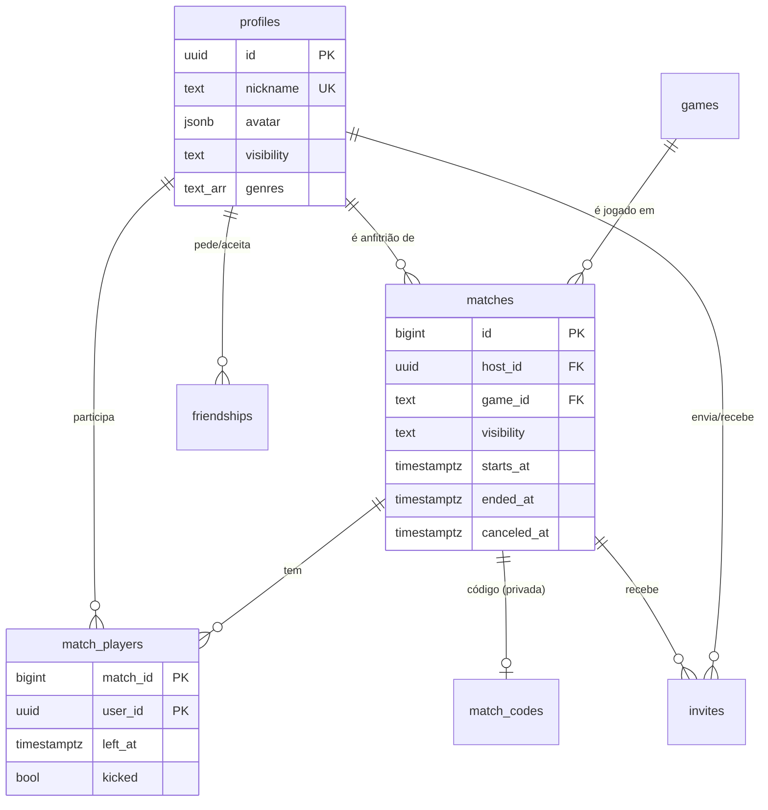
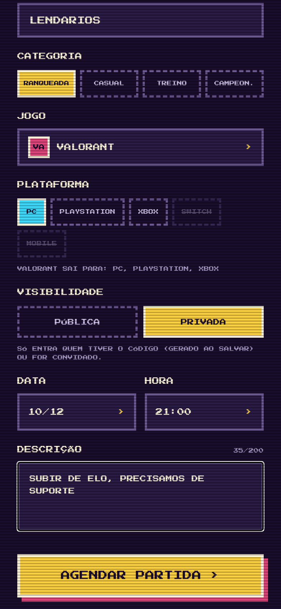
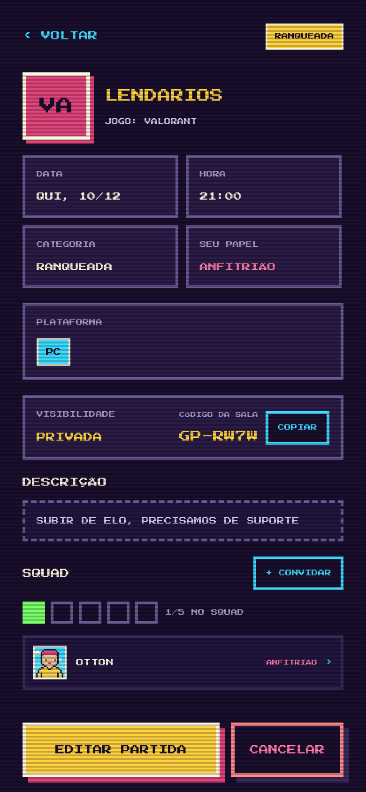
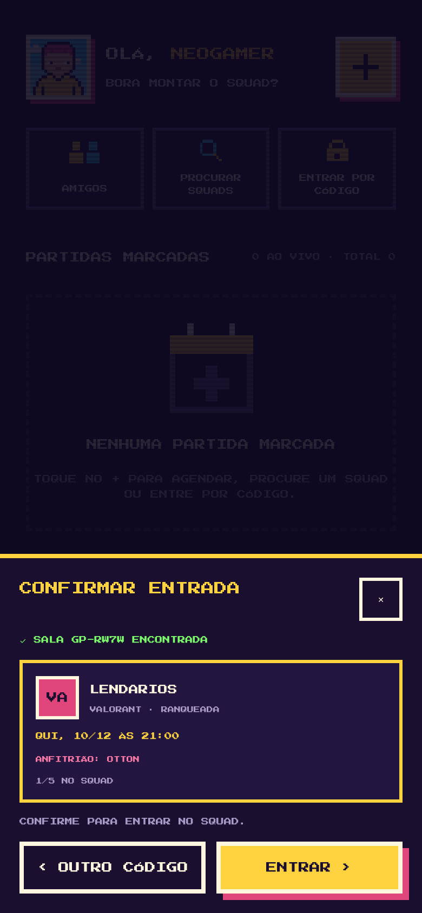
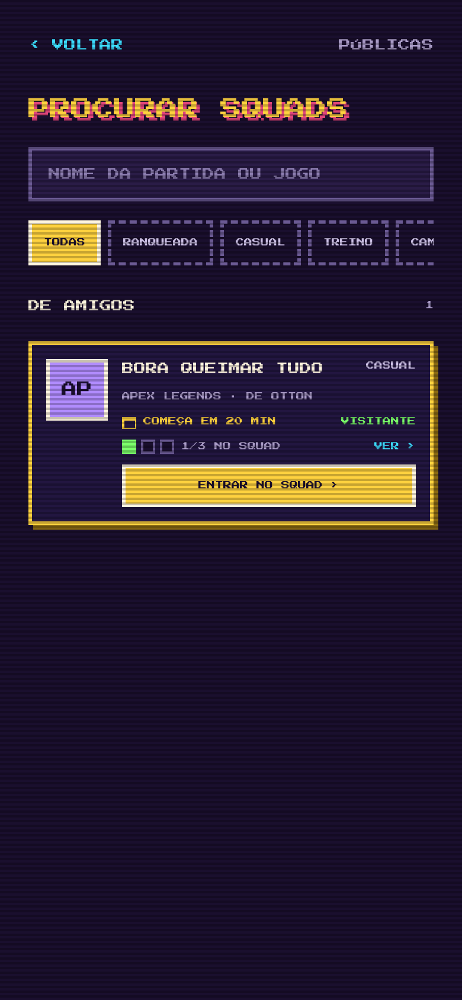
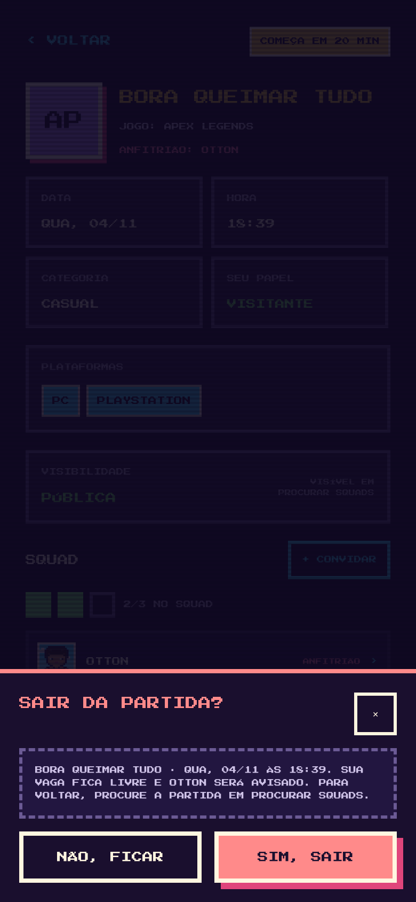
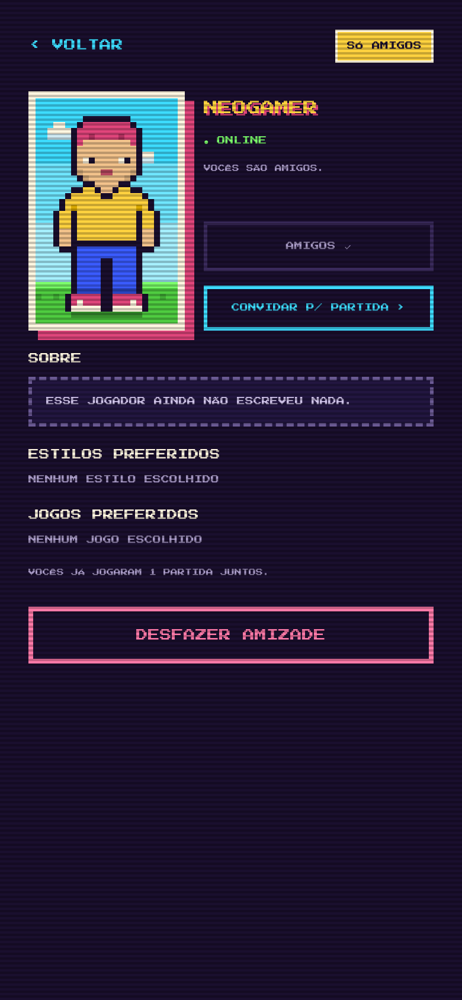
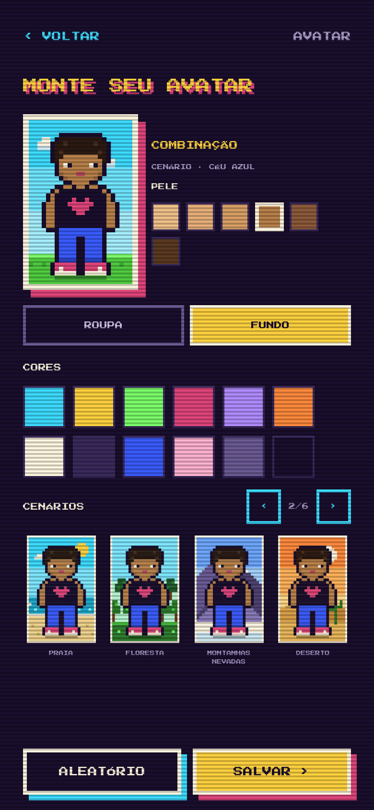
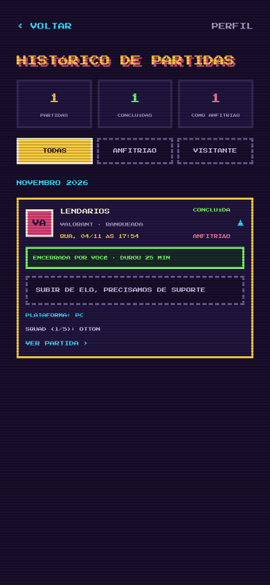

# GamePlay

App mobile para **marcar partidas de jogos online com o seu squad**: agende, convide amigos, converse com o squad, entre por código e acompanhe a partida "ao vivo", tudo num visual retrô em pixel art.


> Projeto acadêmico da disciplina **Programação de App** (Engenharia de Software · UCB), desenvolvido por **Otton Simão Gouveia Cavalcante**.

## O que o app faz

- **Agendar partidas**: jogo (27 títulos), plataformas compatíveis com cada jogo, categoria, data e hora, descrição, e escolha entre **pública** (aparece em Procurar squads) ou **privada** (com código `GP-XXXX`).
- **Ciclo de vida automático**: a partida passa de *agendada* para *começa em breve* (30 min antes) e depois para *em andamento* sozinha, pelo horário. O anfitrião encerra ou cancela (com motivo).
- **Squad**: convidar amigos ou qualquer jogador pelo nick, remover jogadores (só o anfitrião), sair com confirmação, controle de vagas pelo tamanho do squad de cada jogo.
- **Social**: amigos com pedidos, status online/offline, perfil de outros jogadores, e uma tela de *partidas disponíveis* para convidar alguém às suas partidas com vaga.
- **Perfil**: avatar de corpo inteiro em pixel art (20 sets de roupa trocáveis por peça, 6 tons de pele, 12 cores e 22 cenários de fundo), "sobre", estilos e jogos preferidos, e **visibilidade do perfil** (público, só amigos ou privado).
- **Notificações**: convite, começa em breve, começou, partida alterada ou cancelada, removido do squad, pedidos de amizade, quem entrou ou saiu, squad completo, respostas de convites e partidas de amigos. Elas chegam por push no celular e ficam numa central com contador (o sininho da Home). Cada grupo pode ser ligado ou desligado no Perfil, e avisos repetidos se agrupam ("3 JOGADORES ENTRARAM EM LENDÁRIOS"). O som do aviso também é escolhido no Perfil: 3 sons originais em 8 bits (LEVEL UP, BIP BIP, POWER-UP) ou sem som.
- **Chat**: cada partida nasce com o **chat do squad** (para trocar nick do jogo, call etc.), que fecha e vira só leitura quando o anfitrião finaliza ou cancela; quem saiu continua lendo, quem foi removido perde o acesso. Também dá para **conversar com amigos** pelo perfil deles ou pela lista de amigos. Mensagem nova chega por push no celular (agrupada por conversa e fora do sininho), com a chave MENSAGENS no Perfil. A central de chat fica no atalho CHAT da Home, e os chats de partidas que já passaram ficam no Histórico.
- **Histórico**: partidas concluídas, canceladas, de que você saiu ou foi removido, com filtros e estatísticas.

## Destaques técnicos

- **Regras de negócio no banco.** O app lê por *views*/funções protegidas por **Row Level Security** e só escreve por **funções PL/pgSQL `security definer`**. Nenhum cliente consegue, por exemplo, editar a partida de outro, pegar uma vaga lotada ou voltar a uma sala de onde foi removido, mesmo chamando a API direto.
- **Concorrência**: entrar numa partida trava a linha (`SELECT ... FOR UPDATE`), então duas pessoas não pegam a última vaga ao mesmo tempo.
- **Status derivado, não armazenado**: `match_status()` calcula o status a partir de `starts_at`, `ended_at` e `canceled_at`. Não precisa de *job* para "virar" a partida, e o app recalcula pelo relógio para atualizar a tela sem recarregar.
- **Privacidade por design**: perfil privado não devolve os campos ocultos (o filtro é no banco, não na tela), e o código da sala privada fica numa tabela que só os membros conseguem ler.
- **Relógio corrigido pelo servidor**: o app mede a diferença entre o celular e o `now()` do banco (3 medições, compensando a ida e volta da rede, estilo NTP) e usa a hora corrigida nas contagens e no status ao vivo. Se o celular estiver com mais de 2 min de diferença, a Home avisa. Os horários são gravados como `timestamptz`, e cada jogador vê a partida no próprio fuso, mostrado na tela (ex.: BRASÍLIA (UTC-3)).
- **Notificações orientadas a eventos**: as funções do banco gravam em `notifications` (respeitando as preferências e agrupando avisos repetidos), e um Database Webhook chama a Edge Function `send-push`, que entrega pelo Expo Push. Os lembretes de horário são idempotentes (`run_match_reminders`) e rodam pelo pg_cron ou a cada "estou online" dos apps abertos.
- **Tempo real**: a Home, os detalhes e os amigos se atualizam via Supabase Realtime quando alguém entra, sai ou convida.
- **Avatar leve**: os sprites são compostos por camadas (corpo → sapato → calça → torso → cabeça) e desenhados em SVG, juntando pixels vizinhos iguais em retângulos para listas rápidas.
- **Testado**: 131 verificações SQL cobrindo os fluxos, as notificações e as regras de segurança (`supabase/test`), mais TypeScript em modo `strict`.

## Arquitetura

```
 App (Expo / React Native)  ──HTTPS──►  Supabase
   src/app      telas (Expo Router)       ├─ Auth: cadastro, login, recuperar senha
   src/api      única camada que fala      ├─ PostgreSQL: tabelas + RLS + funções (RPC)
                com o Supabase             └─ Realtime: avisa o app quando algo muda
   src/avatar   avatar em pixel art (SVG)
 docs/          página de download (GitHub Pages) + imagens
 supabase/      migrações SQL + testes
```

### Modelo de dados



## Telas

| | | |
|---|---|---|
|  |  |  |
| Home com partida ao vivo | Agendar partida | Detalhes (anfitrião) |
|  |  |  |
| Entrar por código | Procurar squads | Sair da partida |
|  |  |  |
| Perfil de outro jogador | Editor de avatar | Histórico |

Mais telas em [`docs/screenshots`](docs/screenshots).

## Como rodar

### 1. Banco (Supabase)

1. Crie um projeto em <https://supabase.com>.
2. No **SQL Editor**, rode, em ordem, todos os arquivos de `supabase/migrations` (`0001` a `0007`).
3. Em **Authentication → Sign In / Providers → Email**, desligue **Confirm email** para testar mais rápido. Se deixar ligado, o app pede a confirmação antes de entrar.
4. **Esqueci a senha:** em **Authentication → URL Configuration → Redirect URLs**, adicione `gameplay://**` (APK), `exp://**` (Expo Go) e `http://localhost:8081/**` (navegador). O link do e-mail abre a tela de nova senha no próprio app. Em **Site URL**, coloque `https://SEU-USUARIO.github.io/gameplay/redefinir-senha.html` (cole a chave publishable nesse arquivo): é a página usada quando o link não pode abrir o app.
5. Em **Project Settings → API**, copie a **Project URL** e a chave **publishable/anon**.

> No plano grátis, o projeto pausa depois de 1 semana sem uso. Ele pode ser reativado pelo painel.

### 1b. Notificações push (opcional, mas recomendado)

A central de notificações (o sininho) já funciona só com as migrações. Para o aviso **chegar no celular**:

1. **Lembretes de horário:** em **Integrations → Cron**, ative o pg_cron e rode no SQL Editor:
   `select cron.schedule('gameplay-reminders', '* * * * *', 'select public.run_match_reminders()');`
   Sem o cron, os lembretes ainda saem, mas só quando alguém está com o app aberto.
2. **Edge Function:** em **Edge Functions → Deploy a new function**, crie `send-push` e cole `supabase/functions/send-push/index.ts`. Se preferir o terminal: `npx supabase functions deploy send-push`.
3. **Webhook:** em **Database → Webhooks → Create**, escolha a tabela `notifications`, os eventos **Insert** e **Update** e o tipo **Supabase Edge Functions → send-push**.
4. **Android (FCM):** o push da Expo no Android passa pelo Firebase. Crie um projeto no Firebase, baixe o `google-services.json`, aponte para ele em `app.json` (`android.googleServicesFile`) e envie a chave FCM V1 com `npx eas-cli@latest credentials`.
5. **Sons:** os arquivos de `assets/sounds` entram no app pelo plugin do `expo-notifications`. No Android, cada som é um canal (`gp_levelup`, `gp_bip`, `gp_power`, `gp_mudo`), porque o som de um canal não muda depois de criado. Por isso a Edge Function escolhe o canal pelo som salvo no perfil. Os sons personalizados só tocam no APK ou no development build.
6. **Testar:** o push remoto **não funciona no Expo Go no Android**. Use o APK (`--profile preview`) ou um development build. O `npx eas-cli@latest init` grava o `projectId`, que o app precisa para pedir o token.

### 2. App

```bash
npm install
cp .env.example .env      # preencha URL e chave do Supabase
npx expo start -c         # abra no Expo Go (QR code) ou aperte "w" para o navegador
```

### 3. APK para Android

```bash
npx eas-cli@latest build -p android --profile preview
```

Cadastre as duas variáveis do `.env` em **expo.dev → projeto → Environment variables** antes do build.

> Desde 30/09/2026, no Brasil, apps instalados fora da Play Store precisam de desenvolvedor cadastrado no Android Developer Console. A conta de **distribuição limitada** é grátis para até 20 aparelhos.

### 4. Testes do banco

```bash
PGHOST=localhost PGUSER=postgres npm run db:test   # PostgreSQL local, com auth simulado
```

## Estrutura

```
src/
  app/            telas (cada arquivo é uma rota do Expo Router)
  api/            acesso ao Supabase + tipos
  avatar/         dados dos sprites, composição e componente SVG
  components/     UI no estilo retrô (botões, janelas, cartões)
  context/        sessão/perfil (Auth) e rascunho da partida (Draft)
  lib/            datas, status da partida, hooks de carregamento
supabase/
  migrations/     esquema, RLS, funções e catálogo de jogos
  test/           testes dos fluxos em SQL
docs/             página de download (GitHub Pages) e imagens do README
```

## Autor

**Otton Simão Gouveia Cavalcante** · Engenharia de Software · Universidade Católica de Brasília
GitHub: [@Ottonkyu](https://github.com/Ottonkyu)

Licença [MIT](LICENSE).
