# GamePlay

**App mobile para marcar partidas de jogos online com o seu squad**, com visual retrô em pixel art.
Você agenda a partida, chama os amigos, combina tudo no chat do squad e o app avisa no celular quando está na hora de jogar.


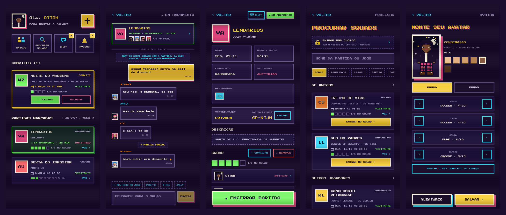

> Projeto da disciplina **Programação de App** (Engenharia de Software · UCB), feito do zero por **Otton Simão Gouveia Cavalcante**: design das telas, app mobile e banco de dados.

## Em 30 segundos

| | |
|---|---|
| **Problema** | Combinar uma partida com amigos vira bagunça no grupo de mensagens: quem vai, que horas, em qual plataforma, qual o nick de cada um. |
| **Solução** | Um app só para isso: a partida tem data, vagas, squad, chat próprio e lembretes automáticos. |
| **Stack** | React Native (Expo) + TypeScript no app · Supabase (PostgreSQL, Auth, Realtime, Edge Functions) no servidor. |
| **Status** | Funcional: APK para Android e versão web. |

## Funcionalidades

- 🗓️ **Agendar partidas**: 27 jogos, plataformas compatíveis com cada um, pública ou privada (com código `GP-XXXX`).
- ⏱️ **Status automático**: *agendada → começa em breve → em andamento*, pelo horário; o anfitrião encerra ou cancela.
- 👥 **Squad**: convites, vagas pelo tamanho do squad de cada jogo, remover e sair com confirmação.
- 💬 **Chat**: cada partida tem o chat do squad (fecha quando a partida acaba) e dá para conversar com amigos.
- 🔔 **Notificações push**: convites, lembretes, quem entrou, mensagens novas, com sons 8 bits e preferências por tipo.
- 🧑‍🎨 **Perfil e avatar** em pixel art (20 roupas, 6 tons de pele, 34 fundos), com controle de privacidade.
- 🤝 **Amigos**, **procurar squads** públicos e **histórico** com estatísticas.

## Telas

| | | |
|:---:|:---:|:---:|
| 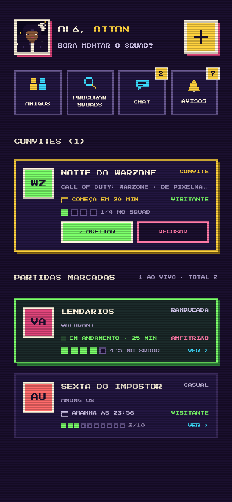 | 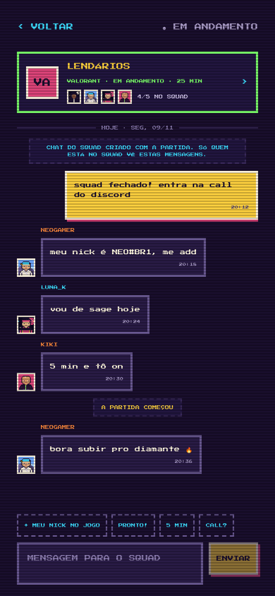 | 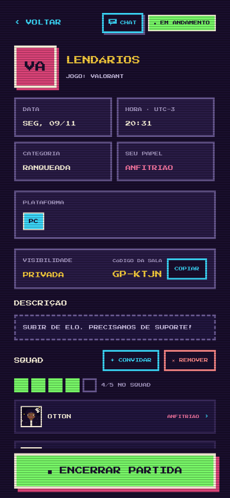 |
| **Home**: convite e partida ao vivo | **Chat do squad** | **Detalhes** (visão do anfitrião) |
| 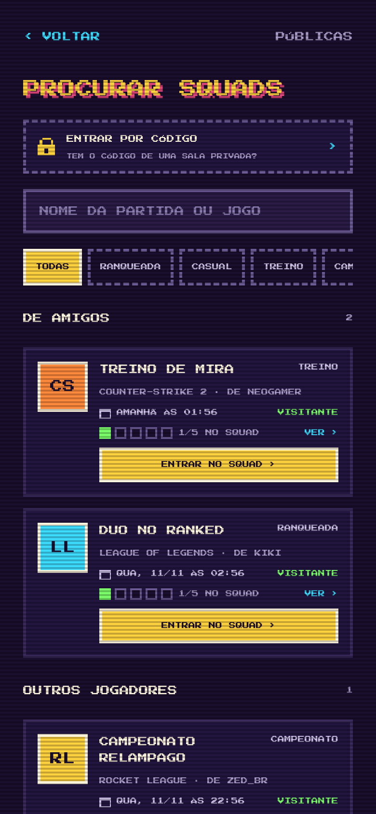 | 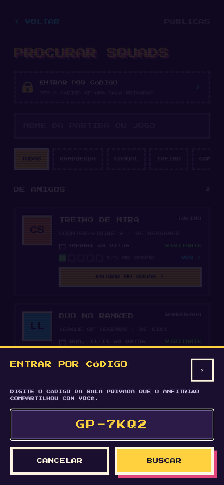 | 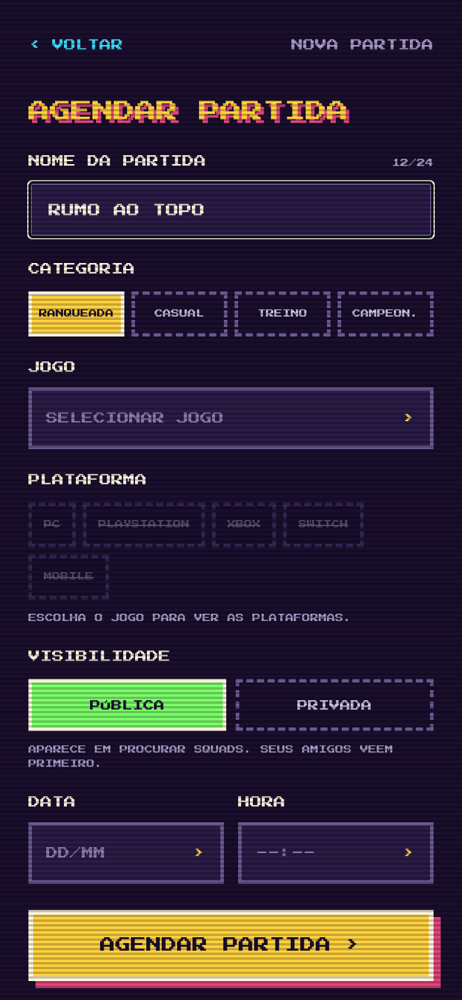 |
| **Procurar squads** | **Entrar por código** | **Agendar partida** |
| 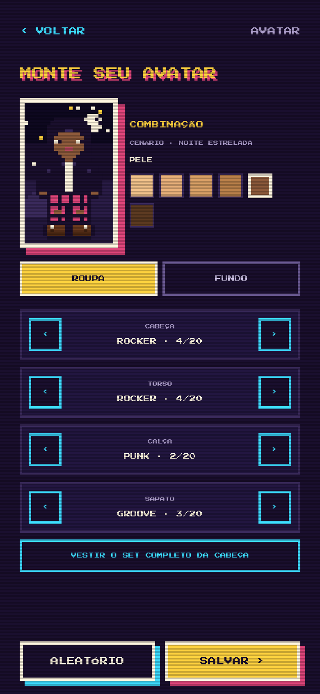 | 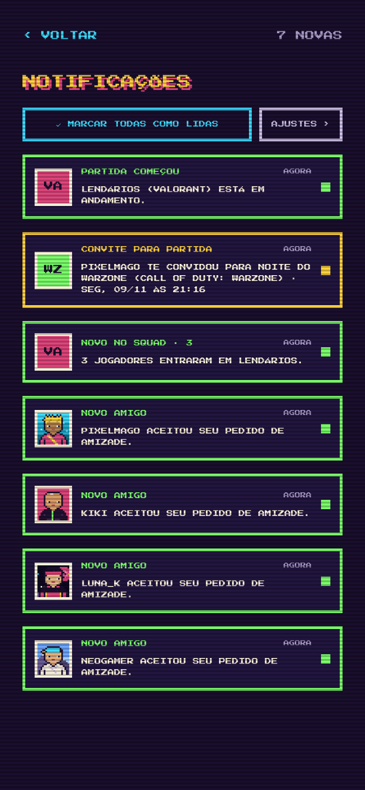 |  |
| **Editor de avatar** | **Notificações** | **Histórico** |

Todas as telas em [`docs/screenshots`](docs/screenshots).

## Destaques técnicos

**Segurança no banco, não só na tela.** O app lê por funções protegidas por *Row Level Security* e só escreve por funções PL/pgSQL. Mesmo chamando a API direto, ninguém edita a partida de outro, entra numa sala lotada ou lê o chat de um squad do qual não faz parte.

**Sem corrida pela última vaga.** Entrar numa partida trava a linha (`SELECT … FOR UPDATE`): se duas pessoas tocam ao mesmo tempo, só uma fica com a vaga.

**Status calculado, não salvo.** `match_status()` deriva o status de `starts_at`, `ended_at` e `canceled_at`. Não precisa de rotina para "virar" a partida, e o app atualiza a tela pelo relógio (corrigido pelo horário do servidor, no estilo NTP).

**Notificações por eventos.** As funções do banco gravam avisos (agrupando repetidos e respeitando as preferências), e um webhook chama uma Edge Function que entrega pelo Expo Push. As telas se atualizam sozinhas via Supabase Realtime.

**Pensado para celular de verdade.** Teclado que não cobre os campos, telas de 320 px, fonte grande do sistema, toque duplo que não duplica ações e mensagens claras sem internet.

**Testado.** 131 verificações SQL cobrindo fluxos, notificações, chat e regras de segurança ([`supabase/test`](supabase/test)), mais TypeScript em modo `strict`.

## Arquitetura

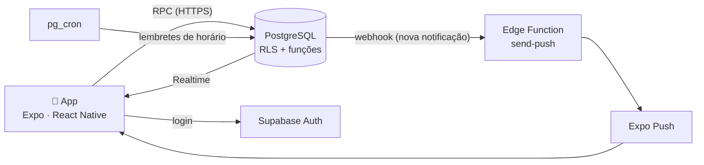

<details>
<summary><b>Modelo de dados</b></summary>

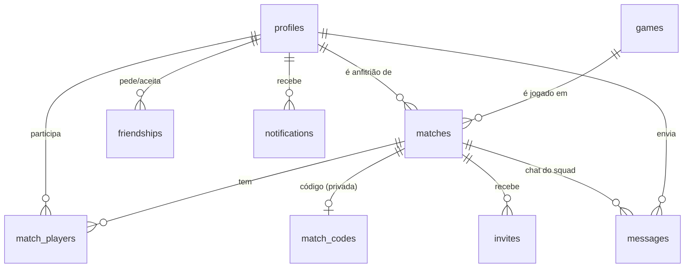

</details>

<details>
<summary><b>Estrutura de pastas</b></summary>

```
src/
  app/          telas (cada arquivo é uma rota do Expo Router)
  api/          única camada que fala com o Supabase + tipos
  avatar/       sprites em camadas desenhados em SVG
  components/   UI retrô (botões, janelas, cartões, chat)
  context/      sessão (Auth) e rascunho da partida
  lib/          datas, status, push, navegação, hooks
supabase/
  migrations/   esquema, RLS, funções, chat e notificações
  functions/    Edge Function de push
  test/         testes em SQL
docs/           GitHub Pages (página de nova senha) e imagens
```

</details>

## Como rodar

```bash
npm install
cp .env.example .env   # URL e chave publishable do seu projeto Supabase
npx expo start         # QR code no Expo Go, ou "w" para abrir no navegador
```

Antes, rode as migrações de `supabase/migrations` (`0001` a `0007`) no SQL Editor do Supabase.
O passo a passo completo (push, APK, recuperação de senha, versão web) está em **[COMO_RODAR.md](COMO_RODAR.md)**.

## Autor

**Otton Simão Gouveia Cavalcante** · Engenharia de Software · Universidade Católica de Brasília
GitHub: [@Ottonkyu](https://github.com/Ottonkyu)

Licença [MIT](LICENSE).
